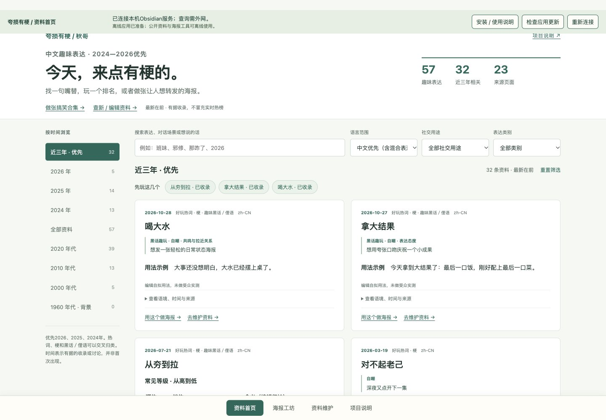
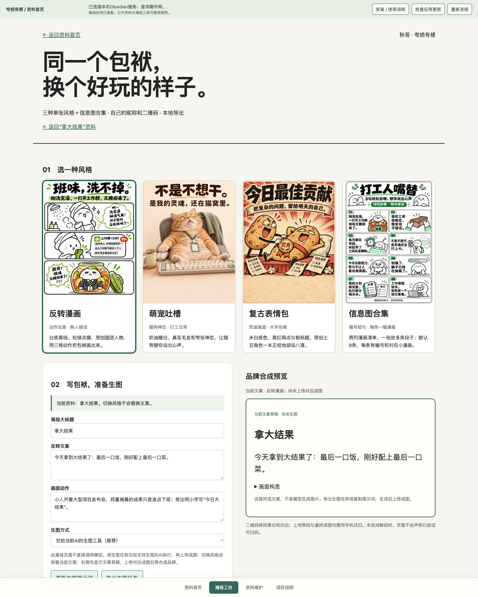
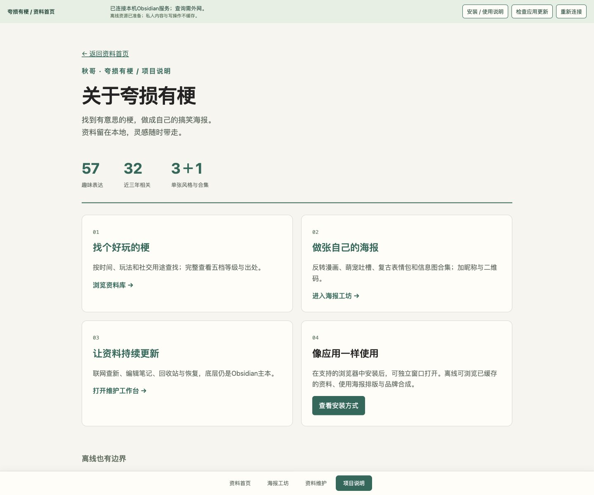

# 夸损有梗

由秋哥发起并整理的中文趣味表达与漫画创作项目。以“社交货币”为选材标准：有意思、有表达力、值得使用或分享。评价排名、态度表达、黑话趣玩、自嘲、调侃、接话都可，默认最新在前。

**当前是 v0.1.0 PWA 开源预览版。** 已完成公开版结构、数据与配置约定，以及60条已审核的趣味表达（其中2024—2026年35条，引用来源26项）；其余85条保留在复审区。已提供AI自动收集、人工审核与意见修订，以及本地RSS查询、编辑与恢复；平台站内热榜接入与生成历史记忆留待后续实现；已提供三种单张风格、信息图合集、本地品牌工坊与PWA基础版；已由用户在Mac上完成Chrome应用安装并确认可用。仓库：[Formangarden524/create-funny-meme-cards](https://github.com/Formangarden524/create-funny-meme-cards)。

## 界面与成图效果

打开应用直接进入资料首页，先看好玩的表达和用法；项目介绍集中在“项目说明”。所有页面共用“资料首页 / 海报工坊 / 资料维护 / 项目说明”导航。



从资料卡片点击“用这个做海报”，可带入文案与画面构思，再返回原条目。以下是已有的AI生成风格样张；修改文案后需要重新生图，网页预览不会自动变图。

| 反转漫画 | 萌宠吐槽 | 复古表情包 |
| --- | --- | --- |
|  |  |  |

**信息图合集：一张放8条段子，每条配一幅小漫画。** 点击图片可查看原图。

<a href="create-funny-meme-cards/assets/poster-studio/samples/collection.png"></a>

<details>
<summary>展开查看海报工坊与项目说明界面</summary>

海报工坊：选风格、编辑文案与画面、准备生图任务、合成昵称和二维码。



项目说明：模块入口、安装方式和离线能力边界。



</details>

界面截图采集于2026-11-05，来自实际运行的本地网页，不是系统安装窗口截图；样张不含个人二维码。原图与采集信息见[截图清单](docs/screenshots/manifest.json)。

## 下载与启动

在本仓库点击 **Code → Download ZIP**，解压整个项目。Mac需已安装Python 3，再双击“启动本地工作台.command”；首次启动需联网安装Python依赖。其他系统可使用终端：

```bash
python3 -m venv .venv
# macOS / Linux
.venv/bin/python -m pip install -r tools/requirements.txt
.venv/bin/python tools/local_workbench.py --open
# Windows：将上面的 .venv/bin/python 换成 .venv\Scripts\python.exe
```

需要AI宿主skill时，安装仓库中的`create-funny-meme-cards`子目录。单独安装skill不会自动安装项目根目录的PWA与本地维护服务。普通使用无需Node；Node只用于开发回归检查。

## 自动收集，你来审核

维护页优先展示**审核收件箱**。点击“手动整理一批”，AI会联网读取来源、排除重复，整理含义、用法和漫画构思，候选先保存在本地私人目录。你可以直接修改文字后通过，也可以写修改意见，让AI重新整理；通过后才写入Obsidian正式笔记并更新资料首页。

需要本机安装并登录Codex CLI；运行会使用对应账号的模型额度。收集失败会显示错误，不返回模拟资料。支持在AI宿主设置定时运行；本机已按用户要求设为每周日19:00，下载仓库不会自动安装这一任务。

详见[自动收集与审核](docs/自动收集与审核.md)。

## 本地更新、编辑与恢复

双击[启动本地工作台.command](启动本地工作台.command)，进入[应用首页](http://127.0.0.1:17861/)，点击“资料维护”。资料首页有“＋ 新增资料”入口，也可在“资料维护”点击同名按钮。填写名称、含义和用法即可存为复审草稿；资料完整、来源已读后可选择“加入资料首页”。还可联网查询并标记新发现线索、编辑Markdown、删除到回收站、恢复条目或旧版本。底层数据保存在现有Obsidian知识库，成功修改后重建预览。查询是公开RSS检索，不等于实时平台热榜；线索需核查后正式收录。详见[使用说明](docs/本地维护工作台.md)。

## PWA应用

启动本地服务后，在系统浏览器打开[应用首页](http://127.0.0.1:17861/)。资料首页、海报工坊、资料维护和项目说明使用统一导航；“安装 / 使用说明”提供浏览器安装指引。首次完成缓存后，即使本地服务停止，也可普通重开、浏览资料、制作海报并合成昵称与二维码；编辑与联网采集需要恢复服务。

当前是本机PWA预览，Mac安装已获用户确认；未部署公网网站，也未做手机同步。直接双击HTML的文件预览不会启用PWA。见[PWA使用与实测记录](docs/PWA使用与核查_20261105.md)。

## Obsidian本地维护

从[知识库首页](知识库/首页.md)开始。原始142篇条目、52篇来源与3篇待核线索保留为可编辑笔记；主库仅导出通过趣味与语境复审的条目；编辑主本是这些Markdown，JSON与网页由导出工具重建。详见[日常维护](知识库/维护说明.md)和[GitHub同步与发布方案](docs/Obsidian与GitHub维护方案.md)。项目通过独立GitHub仓库维护版本；没有启用自动同步。

## 海报与个人品牌

[打开海报工坊](create-funny-meme-cards/assets/poster-studio/index.html)：反转漫画、萌宠吐槽、复古表情包三种单张风格，另有[信息图合集](create-funny-meme-cards/assets/poster-studio/index.html?style=collection)：默认8条、两列四行，每条短句配小漫画。可填写或辅助起昵称，上传原二维码，或用已有网址生成码；独立合成后下载PNG，默认保留项目出处小字。个人微信码需本人上传，不能从昵称生成。

在工坊选好文案与风格，点击“下载生图任务”，把 JSON 文件发到 Codex 对话并请它生成海报。下载生成的图片后，回到工坊点“导入成图”，再添加昵称和二维码并下载品牌 PNG。也可以把提示词交给你使用的其他生图工具。昵称和二维码只在当前页面内存中处理。详见[使用与边界](docs/三风格海报与品牌工坊.md)。

## 先看效果

- [打开交互预览](预览.html)：默认近三年，按时间、语言和三类表达筛选，查看来源与漫画构思；离线可用，无需安装依赖。
- [近期表达阅读版](docs/年代基础包_阅读版.md)：逐条查看释义、年份含义、来源与使用提示。
- [知识到文案的3组演示](examples/创作演示.md)：检查资料如何转成聊天文案与漫画分镜。该文案演示未逐组生图；海报工坊另有三风格实图样张。
- [第一版功能与验收](docs/功能与验收.md)：哪些已完成、哪些仍是后续计划。

## 社交用途

60条主库表达均有具体场景、用法示例和适用范围。条目可独立使用，有些还提供可选接话。首页也支持评价排名、态度表达、黑话趣玩等用途筛选。对话为编辑自拟候选，尚未做受众实测；历史表达保留时间依据，不冒充当下热榜。详见[社交用法与选材标准](知识库/社交用法与选材标准.md)。

## 收集重点

1. 好玩热词：能自然用于生活笑点、自嘲、夸张和接话，纯知识术语不收。
2. 梗：句式、图像、动作、音乐等传播格式及上下文。
3. 趣味黑话／俚语：有生活笑点的社群、游戏和职场表达。

中文优先，英文只补充已有中国大陆实际使用与传播证据的表达。海外独热候选及知识概念移至[复审区](知识库/归档与复审.md)，不会混入主库。

“最近”按有据记录排序；不是把旧词的首创日期改成年份较新的日期。类别可交叉，变体与别名归入同条。

## 第一版要做什么

1. 通过宿主已授权的联网工具发现符合中文趣味定位的新梗，核查来源并标明实际平台覆盖。
2. 在用户自己的数据目录保存生成与反馈历史，按指令选择全新、复用或改编。
3. 生成可爱漫画卡片，允许配置昵称、二维码和署名。
4. 随包附带年代知识，保留项目作者和第三方素材各自的出处。

目前具备AI联网整理与人工审核、资料维护、宿主生图流程与本地品牌工坊；平台专用站内热榜适配与生成作品的自动历史归档仍未实现。联网和生图能力需要宿主工具，skill文件本身不提供模型服务或后台任务。

## 目录

```text
知识库/                       Obsidian编辑主本、年代与来源索引
tools/build_from_obsidian.py   从笔记导出并校验知识数据与预览
create-funny-meme-cards/       公开版skill预览，尚未完成运行验证
  SKILL.md                    能力入口与阶段边界
  agents/openai.yaml           UI元数据
  references/                 编辑、视觉、搜索、记忆、品牌约定
  assets/brand.example.json    个人配置示例，无私人二维码
  assets/knowledge/           公共知识包及轻量索引
create-funny-meme-cards/references/schemas/
                              公共知识与运行事件的数据契约
examples/                     调用示例与编辑演示
preview.js                    预览页交互逻辑
预览.html                     自包含离线浏览页（内嵌相同交互逻辑）
docs/                         范围、采集规范、核查与许可说明
tools/validate_package.py      阶段资料一致性检查，不是记忆/搜索实现
```

## 数据与个人配置

维护者编辑“知识库”中的Markdown，再导出公共知识包；skill运行时把生成的公共知识包作为只读资料。以后每位使用者的作品、二维码和历史存在其自选目录。`create-funny-meme-cards/assets/brand.example.json`中的`data_dir=null`表示未配置持久化。个人配置应另存为`brand.local.json`并由Git忽略。

默认优先2024—2026年的35条趣味资料，全部60条主库表达按有据记录的日期倒序排列。更早的内容作为历史补充。它们是可追溯资料，不是各年代最高热度排名。当前未测量实时热度，未分发第三方图片、音频或视频。

## 作者与许可

项目作者：**秋哥**。代码、skill与自行编写的说明采用[MIT许可](LICENSE)，再分发时保留版权与许可声明。第三方依赖保留原许可，热梗来源及第三方权利范围见[作者与许可说明](create-funny-meme-cards/references/attribution.md)。

作品上的项目出处默认开启，可与使用者昵称和二维码同时出现；MIT许可不额外要求每张生成图片强制署名。

## 阶段检查

执行`python3 tools/validate_package.py`可检查数据ID、来源引用、索引、阶段数量及配置边界。完整JSON Schema与skill前置校验结果见[核查记录](docs/核查记录.md)。
