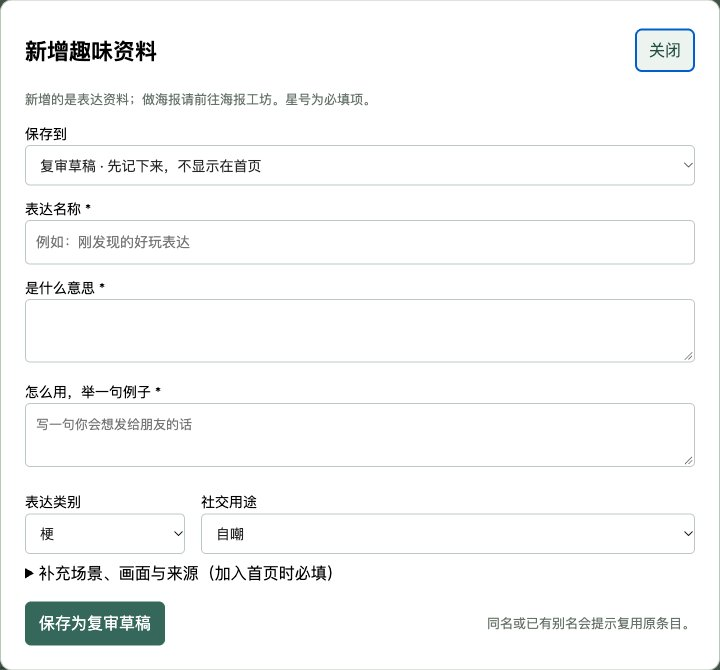

# 本地维护工作台

工作台把查询更新、编辑、回收站和恢复接到当前Obsidian笔记。双击项目根目录的“启动本地工作台.command”，打开[应用首页](http://127.0.0.1:17861/)，点击“资料维护”；也可直接打开[本地工作台](http://127.0.0.1:17861/本地工作台.html)。首次启动会在项目.venv中安装tools/requirements.txt的依赖；当前机器已准备该环境。终端保持运行，Ctrl+C可停止，不安装开机启动或定时任务。

## 优先使用自动收集与审核

维护页顶部点击“手动整理一批”，AI整理后进入审核收件箱。可通过、直接改文字、提交修改意见或跳过；通过才入库。意见提交后尝试立即启动修订，已有任务运行时保留意见，下一轮处理。手动新增作为补充入口折叠在下方。详见[自动收集与审核](自动收集与审核.md)。

## 手动新增资料

资料首页点击“＋ 新增资料”，会进入维护页并自动打开表单；维护页顶部也有同名按钮。

1. 填表达名称、含义与一句用法，选择表达类别和社交用途。
2. 默认“复审草稿”：先记下来，保存到Obsidian的“知识库/条目”，在维护页“复审区”查找，暂不进入资料首页。可以继续编辑草稿。
3. 要立即展示，选择“资料首页”。补充具体场景、笑点、漫画构思、有据讨论日期、来源网址与标题、支持范围和来源限制，并确认本人已阅读来源。程序不代替用户核查来源或测量热度。
4. 保存后显示真实笔记路径；正式条目可直接跳回资料首页查看。已有同名/别名会提示编辑原条目；删除后的同名条目应先恢复。

来源不足时应先存草稿。草稿后续转正式，当前可在Obsidian完成原笔记、来源笔记和复审结论后重建；页面暂未提供草稿一键发布。来源未读不能仅勾选复选框冒充核查。离线不能提交新增，不会排队保存；重连时保留尚未提交的表单文字。新增条目支持原有的删除、回收站与版本恢复。

## 查询更新

点击“联网查询更新”，可改检索词，默认“网络热梗”。当前使用Google News近7天中文检索RSS及Bing检索RSS作为公开线索源，不接个人平台账号，不代表覆盖了小红书、知乎、B站或YouTube的站内热榜。页面显示每个源的失败原因；若都失败会保留失败记录，不返回伪造候选。

- 新发现线索：此前本地查询尚未见过的链接。首次查询结果可能都是“新发现”，不等于梗刚出现。
- 关联已有表达：标题匹配当前主库名称或别名的初步提示，可能有误匹配；不等于已经更新正式条目。
- 来源日期：保留检索源给出的页面时间，未知不补猜；按日期倒序，不能冒充逐梗热度排名。Bing结果可能包含旧页，不能统一视为近7天。
- 可点击来源核查，并保存为“待核线索”。读原页、提取表达、核实大陆传播与趣味用途后再收录正式条目。当前不会把检索文章自动变成已审核的梗。

查询记录完整保存在“知识库/采集收件箱/scan-*.md”，包括检索词、日期、候选、来源、已见状态和失败原因。它们是本地工作笔记，默认被Git忽略。保存为待核线索后，会生成“知识库/待核线索/pending-*.md”，并更新公开待核索引。

## 编辑与历史恢复

点击条目“编辑”可修改YAML和Markdown，保存到原来的“知识库/条目/ID.md”。保存前检查字段、ID、来源与引用，成功后重新导出预览；校验失败则退回原文。修改前版本存“知识库/私人/编辑历史/ID/版本号.md”；在编辑器中点击“查看可恢复版本”，展开确认内容后恢复，恢复前的当前版本也会保留。

若Obsidian或另一窗口已修改同一笔记，页面提示重新打开，避免静默覆盖。不做自动合并。直接在Obsidian编辑后，可点“从Obsidian重新导出”刷新知识包与预览。

## 删除和回收站

删除将原文保存在“知识库/私人/回收站/ID.md”，复审清单标记trash，主库和默认索引不再展示。原路径保留“已移到回收站”的短笔记，保证已有Obsidian链接仍能定位。切换“回收站”可恢复原文与原有主库/复审状态；不提供永久清空操作。

独立演示文案、成图样张不连带删除；它们是独立作品，引用的原始笔记路径仍保留。删除正式条目不会抹去已发布作品或历史记录。

## 本地存储与访问

正式内容、来源、复审状态、待核线索、查询记录、编辑历史和回收站均在本项目“知识库”目录，作为现有Obsidian库的一部分。JSON与网页是导出物；没有另设云端数据库，也不写入浏览器localStorage作为主本。

服务只监听127.0.0.1；写请求校验同源与页面令牌。私人目录不通过静态页面提供。查询时会将检索词发送给上述公开检索源；不会把整库笔记或私人二维码上传。该服务供本机使用，不能作为GitHub Pages服务部署；未来公开网站应只发布静态导出内容。

[知识库首页](../知识库/首页.md) · [静态预览](../预览.html)

## PWA入口

工作台现已接入统一导航和离线应用壳。离线可以看缓存资料和使用海报工具；服务未连接时不提供笔记写入，也不会排队提交修改。成功编辑、删除或恢复后刷新公开离线副本，私人笔记正文和API响应不进入PWA缓存。详见[PWA使用与核查](PWA使用与核查_20261105.md)。
